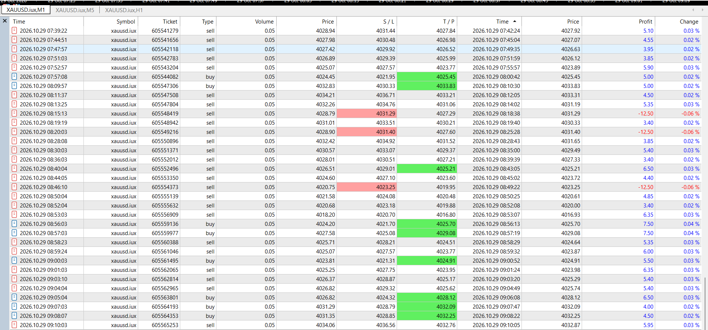
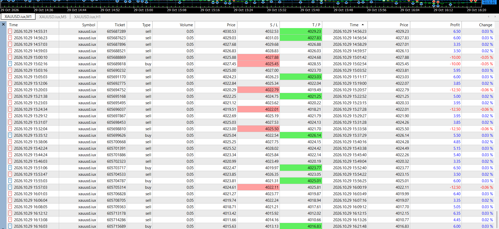

# MT5 Forward-Testing Evidence — Original Screenshots (29 October 2026)

**Project:** Algorithmic Trading Systems Research  
**Platform:** MetaTrader 5 (MT5), XAUUSD M1 order-history view  
**Evidence:** Two authentic, unredacted screenshots provided and explicitly authorized for inclusion by the project owner.

## Screenshot A — morning excerpt

## Screenshot B — afternoon excerpt

The first and third images supplied in the original discussion were duplicates; only the **two distinct excerpts** are used here. These files are original screenshots, not illustrative diagrams or recreated charts.

## What the screenshots demonstrate

- The platform's order-history view contains multiple completed BUY/SELL orders, with entry and closing information and trade-by-trade outcomes.
- **Some entries and exits were successful during the displayed windows**, while other trades incurred losses, including stop-loss outcomes.
- It is plausible that **some favorable market conditions, including directional or trending phases**, can suit a given algorithmic strategy; however, these screenshots alone **cannot establish** which market regime caused those wins or that the EA performs consistently well when markets trend.
- Performance is **not uniformly positive**. Losing trades, changing volatility and unfavorable market conditions remain important research and engineering challenges.

## Engineering focus

The project focuses on building and testing automated software, observing order execution, reviewing trade histories, diagnosing failure cases, designing repeatable experiments, and evaluating systems across different market conditions.

## Interpretation limits

These selected screenshots **are not** a full accounting statement, a complete backtest, a statistically representative sample or proof of profitability. Do not infer an overall win rate, total net return, Sharpe ratio, maximum drawdown, or future performance from these excerpts. Account mode (demo/real) is not independently established by the captured pixels alone.

## Publication notice

The owner **explicitly approved uploading these two original images without redaction**. They reveal ticket numbers, execution timestamps, symbol, order directions, volume, prices, SL/TP levels, and per-trade P&L. The repository is currently Private; **changing its visibility to Public would publish all these details and the commit history as well**. Actual EA source code, proprietary decision rules and credentials are not published here.

This portfolio material demonstrates software testing and documentation, **not investment advice or a claim of guaranteed or continuous profits**.

[Back to algorithmic trading project](algorithmic-trading-research.md) · [ภาษาไทย](mt5-forward-testing-evidence_TH.md)
