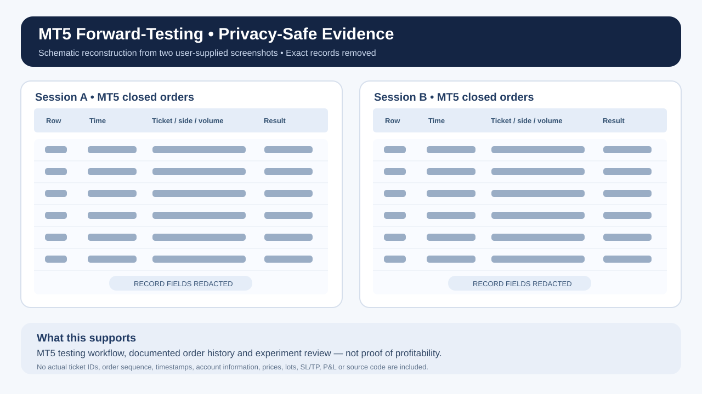

# หลักฐานการทดสอบ MT5 — เวอร์ชันปกปิดข้อมูลสำคัญ

**โครงงาน:** Algorithmic Trading Systems Research  
**แพลตฟอร์ม:** MetaTrader 5  
**ข้อมูลตั้งต้น:** ภาพหน้าจอประวัติคำสั่งจากเจ้าของโปรเจกต์ 2 ช่วงที่แตกต่างกัน ในเดือนตุลาคม 2026  
**รูปแบบการนำเสนอ:** ภาพวาดประกอบที่สร้างใหม่โดย **ไม่ใส่ข้อมูลรายการเทรดจริง** และไม่อัปโหลดภาพหน้าจอต้นฉบับ

## สิ่งที่ภาพต้นฉบับแสดง

ภาพต้นฉบับมีรายการคำสั่งที่ปิดแล้วหลายรายการในหน้าประวัติของ MT5 รวมถึงข้อมูลเวลาคำสั่ง ประเภทคำสั่ง ราคาและผลลัพธ์รายไม้ ภาพลำดับที่ 1 และ 3 เป็นช่วงข้อมูลเดียวกัน จึงนับเป็นหลักฐาน 2 ช่วง ไม่ใช่ 3 ช่วง

## ทักษะด้านวิศวกรรมซอฟต์แวร์ที่แสดง

- ใช้ MetaTrader 5 ทดสอบและติดตามการส่งคำสั่งอัตโนมัติ
- ตรวจสอบประวัติคำสั่งเข้า–ออกและบันทึกผลการทดลอง
- วิเคราะห์ข้อผิดพลาดของระบบจากข้อมูลการทดสอบ
- เปรียบเทียบการทดลองพร้อมพิจารณาความสามารถในการทดสอบซ้ำและข้อจำกัด
- จัดทำเอกสารสรุปโดยไม่เปิดเผยระบบภายใน

## ข้อจำกัดของหลักฐาน

- ภาพที่แสดงเป็น **ภาพประกอบที่สร้างใหม่** ไม่ใช่ภาพ MT5 ต้นฉบับหรือกราฟกำไรจริง
- ภาพหน้าจอเพียงอย่างเดียวไม่สามารถยืนยันได้ว่าทุกการเทรดเป็นบัญชี Demo หรือพิสูจน์ว่าระบบมีกำไรสุทธิในระยะยาว
- ไม่คำนวณ Win Rate, กำไรสุทธิ, Drawdown หรือผลตอบแทนจากภาพบางช่วงแล้วนำมาอ้างเป็นผลทั้งระบบ
- สามารถนำภาพต้นฉบับที่ผ่านการตรวจความลับไปให้ผู้สัมภาษณ์ตรวจเป็นการส่วนตัวได้หากเหมาะสม

ข้อมูลตั๋วคำสั่ง เวลาแบบละเอียด ลำดับ BUY/SELL ราคา Lot Size SL/TP และกำไรรายไม้ รวมถึงโค้ดและพารามิเตอร์ EA จริง **ไม่ได้เผยแพร่**

[กลับไปหน้าโครงงาน](algorithmic-trading-research.md) · [English](mt5-forward-testing-evidence.md)
