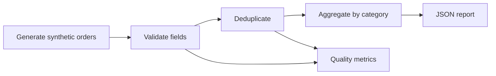

# Synthetic Sales Analytics Pipeline

**Type:** AI-assisted educational portfolio demonstration; not a real client project  
**Skills demonstrated:** Python, data cleaning, quality checks, deduplication, business metrics and unit testing  
**Data:** 100% artificially generated; no actual customers or businesses.

## Problem

Analytics reports can be distorted by duplicate, incomplete or invalid records. This example demonstrates a small end-to-end pipeline that generates mock retail orders, detects quality problems, and summarizes clean records.

## Pipeline



## Reproducible sample output

The built-in demo generates 120 accepted orders, plus one intentionally duplicated and one invalid order.

| Metric | Artificial example |
|---|---:|
| Input rows | 122 |
| Valid accepted rows | 120 |
| Duplicate rows | 1 |
| Invalid rows | 1 |
| Synthetic revenue | 9,471.84 (unitless demo currency) |

For the sample's category breakdown, run the program locally.

## Run & test

Requires Python 3.10+ and the standard library only.

```bash
python examples/synthetic_sales_pipeline.py
python -m unittest discover -s tests -v
```

## What this project demonstrates

- Defensive data validation and duplicate handling
- Deterministic synthetic data for reproducible demonstrations
- Precise monetary calculations with Python `Decimal`
- Aggregation by business category
- Unit tests for missing/bad inputs, duplication and reconciliation

**Not claimed:** production deployment, paid industry experience, genuine customer outcomes, trading strategy, ML model training, or any real data access. The example was prepared with AI assistance and should be reviewed and understood before using it in an interview.
